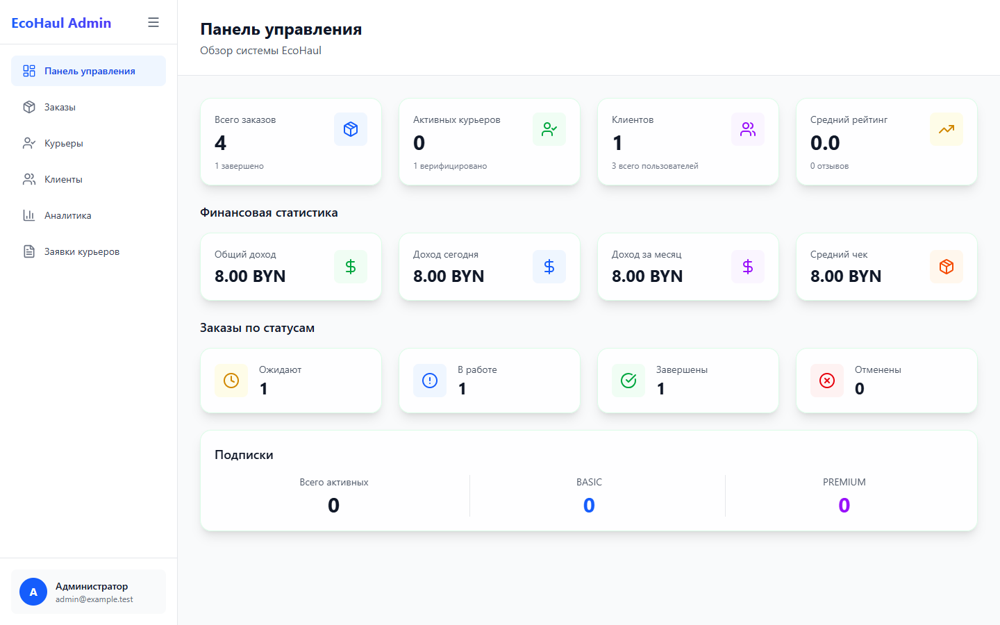

# EcoHaul

**Waste collection, from a Telegram request to a completed courier order.**

[](https://github.com/br1maks/EcoHaul/actions/workflows/ci.yml)

EcoHaul is a full-stack application for on-demand household waste collection in Minsk.
Clients manage pickup addresses and orders through a Telegram Mini App; couriers accept
and complete jobs; administrators manage users, applications, orders and analytics.

The project focuses on **Python backend engineering**: asynchronous APIs, PostgreSQL
transactions, role-based access, background jobs and event-driven interfaces.
The React/TypeScript frontend provides a working interface for each role.



*Administrator dashboard. All screenshots use synthetic demonstration data.*
[View client, courier and admin screens](docs/screenshots.md).

[Quick start](#quick-start) · [Architecture](docs/architecture.md) · [API guide](docs/api.md) · [Development](docs/development.md) · [Security](docs/security.md) · [Payment recovery](docs/payments.md)

## At a glance

| Backend | Data & jobs | Frontend | Delivery |
| --- | --- | --- | --- |
| Python · FastAPI · Pydantic | PostgreSQL 16 · PostGIS | React 19 · TypeScript | Docker Compose · Nginx |
| Async SQLAlchemy · Alembic | Redis · Celery · Celery Beat | Vite · Tailwind CSS 4 · Zustand | GitHub Actions |
| JWT · Telegram initData validation | Row locks · spatial data | Role-specific routes · WebSocket events | Locked Python/npm dependencies |

## What it does

- **Client workflow:** save addresses, schedule pickup, see pricing and order history, review couriers.
- **Courier workflow:** accept available orders, update delivery status, manage shifts and availability.
- **Admin workflow:** inspect clients and couriers, review applications, assign orders and view analytics.
- **Order coordination:** server-calculated pricing, expiring unaccepted orders and protected state transitions.
- **Notifications:** authenticated WebSocket updates and optional background Telegram messages.
- **Subscriptions and checkout:** tiered discounts, durable checkout identity, verified settlement and scheduled recovery after provider failures.

Payment integration is demonstrated in code and tests. A live merchant deployment,
including BYN/country compatibility, is not claimed. Details: [integration boundaries](docs/security.md#before-a-real-deployment).

## Engineering highlights

**One order, one courier.** Acceptance uses a PostgreSQL row lock and rechecks status
and expiration. An integration test races two couriers against the same order.

**State and events commit together.** A transactional outbox records notification and
cache work alongside domain changes. Failure-injection tests check rollback, retry,
stream ordering and the crash window that can cause duplicate publication.
[Delivery model and recovery](docs/events.md).

**Payment uncertainty has a recovery path.** Immutable checkout intent commits before
provider I/O; retries reuse its key, early callbacks can settle it, and reconciliation
covers missed notifications. [Failure matrix and operator procedure](docs/payments.md).

**Sessions can be revoked.** Refresh rotation detects replay, password changes invalidate
old sessions, and sockets use single-use tickets with ongoing checks.
[Security model and regression evidence](docs/security.md).

**Permissions backed by current data.** JWTs identify a user; authorization checks the
active database record and required role. Address and payment access is owner-scoped.

**External input is verified.** Telegram launch signatures and timestamps are validated.
Payment notifications are confirmed through the provider API before local state changes.

**A clean checkout is part of the workflow.** Python and npm lock files are committed;
CI runs backend tests against PostgreSQL/PostGIS and Redis, checks fresh migrations,
and builds/lints the frontend.

### Technical review guide

| Question | Design and implementation evidence |
| --- | --- |
| What happens when two couriers accept the same order? | [State machine, row locks and concurrent-request test](docs/architecture.md#3-order-lifecycle-and-concurrency) |
| Where does a database transaction end, and what can fail afterward? | [Commit boundaries, payment races and bulk-command semantics](docs/architecture.md#4-transaction-boundaries-and-failure-modes) |
| Why do the API and Celery use different connection strategies? | [Async sessions, eager loading and event-loop lifetimes](docs/architecture.md#5-async-sessions-and-worker-event-loops) |
| Which identity and permissions does the server actually trust? | [Telegram validation](docs/security.md#2-telegram-authentication-canonicalization-provenance-and-freshness), [JWT lifecycle](docs/security.md#3-jwt-lifecycle-and-browser-session-behavior) and [object authorization](docs/security.md#4-authorization-is-role--account-state--object-relationship) |
| Can a forged or repeated payment callback grant access? | [Provider verification, amount checks and settlement idempotency](docs/security.md#6-payment-integrity-and-idempotency) |
| What must change before adding API workers or stronger delivery guarantees? | [Transactional delivery, retries, browser recovery and scaling boundaries](docs/architecture.md#6-cache-jobs-and-realtime-delivery) |

## Quick start

Requirements: Docker with Compose v2 and Python 3.11+ for the small setup utility.
From the repository root:

```sh
git clone https://github.com/br1maks/EcoHaul.git
cd EcoHaul
python scripts/setup_local.py
docker compose --env-file .env -f docker/docker-compose.yml up -d --build --wait
```

| Open | Address |
| --- | --- |
| Application | http://localhost:8080 |
| Interactive API documentation | http://localhost:8001/api/docs |
| Dependency readiness | http://localhost:8001/health |

Migrations run automatically before the API starts. The setup utility generates local
secrets and enables API documentation; Telegram and development authentication stay
disabled. No bot or merchant credentials are needed to inspect the API and admin UI.

To create a local administrator:

```sh
docker compose --env-file .env -f docker/docker-compose.yml exec backend python scripts/create_admin.py --email admin@example.test
```

Enter a password when prompted, then open `/admin/login` in the application.
For the client workflow, configure Telegram and launch the Mini App from the bot.
See [development](docs/development.md) for source-based setup, synthetic demo data and troubleshooting.

## Quality checks

```sh
# Backend unit tests; no services required
cd backend
poetry install --no-root
poetry run pytest -q

# Frontend
cd ../frontend
npm ci
npm run lint -- --max-warnings 0
npm test
npm run build
```

PostgreSQL integration tests are opt-in: start the isolated test services and run
`poetry run pytest --integration -q`. The [testing guide](docs/development.md#postgresql--redis-integration-tests)
explains the fixed disposable test database and ports. Telegram/payment delivery is
mocked in tests; PostgreSQL transactions and Redis are real.

## Project map

```text
backend/
  app/api/v1/       HTTP endpoints and access control
  app/core/         Settings, sessions, security, Redis
  app/models/       SQLAlchemy models and relations
  app/schemas/      Pydantic contracts
  app/services/     External integrations
  app/tasks/        Background and scheduled jobs
  app/websocket/    Connections and event payloads
  migrations/      Alembic schema history
  tests/           Unit and PostgreSQL integration tests
frontend/src/
  lib/api/         Authenticated HTTP and WebSocket clients
  pages/           Client, courier and admin interfaces
  shared/          Components and domain types
  store/           Zustand state
scripts/           Local setup, OpenAPI export, synthetic demo data
docker/            Images, Nginx and Compose configurations
docs/              Architecture, API, development and security
```

## Scope and next steps

This is a portfolio application with explicit deployment boundaries. WebSocket delivery
uses a single-process connection registry. Delivery intents are durable and retryable;
end-user receipt is not exactly once. Checkout idempotency, scheduled payment recovery and revocable refresh sessions are
implemented. Further work includes distributed event fan-out, deployment monitoring,
load measurements and live merchant acceptance.

Keeping these tradeoffs explicit makes the implementation easier to inspect and extend.
See [architecture](docs/architecture.md) and [security](docs/security.md) for the reasoning.

---

**Кратко по-русски:** сервис вывоза мусора через Telegram Mini App с интерфейсами клиента,
курьера и администратора. Основной акцент — FastAPI, транзакции PostgreSQL, права доступа,
фоновые задачи, тесты и воспроизводимый запуск. Интерфейс приложения — на русском языке.
