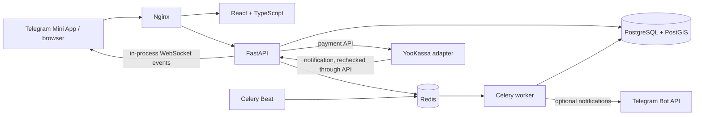
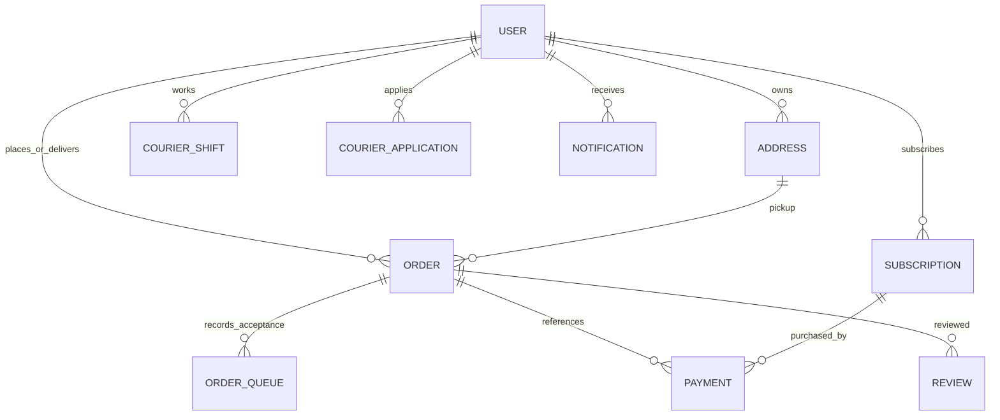
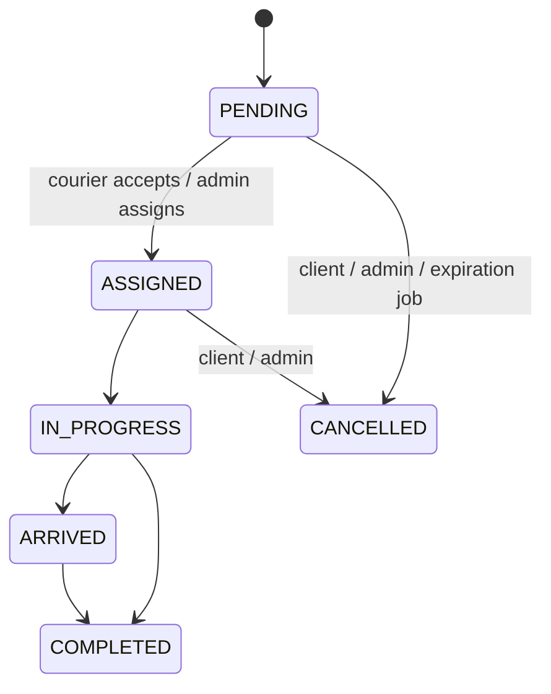

# Architecture

EcoHaul is a modular monolith with a React client, an asynchronous FastAPI API,
PostgreSQL/PostGIS for persistent data, and Redis for caching and Celery transport.
The user interface is in Russian; code and API documentation are available here in English.

## Boundaries

| Directory | Responsibility |
| --- | --- |
| `backend/app/api/v1` | Request validation, authentication dependencies, domain endpoints |
| `backend/app/models` | SQLAlchemy models, relations, derived properties |
| `backend/app/schemas` | Pydantic request/response contracts |
| `backend/app/core` | Settings, database sessions, JWT and Telegram validation, Redis |
| `backend/app/services` | Payment and verification integrations |
| `backend/app/tasks` | Notifications, order expiration, subscription expiration |
| `backend/app/websocket` | Authenticated connections and event payloads |
| `frontend/src/lib/api` | JWT-aware HTTP clients and WebSocket transport |
| `frontend/src/pages` | Client, courier and admin workflows |

The current implementation keeps several domain operations in route handlers.
Extracting transaction-oriented services is a reasonable next step as the domain grows;
the directory structure does not imply that a separate service layer already exists everywhere.

The API pools asynchronous database connections. Celery workers set
`DB_USE_NULL_POOL=True`: scheduled tasks create a new event loop per invocation, so
connections must not be reused across those loops. An integration regression test
runs the expiration task in two consecutive loops.

## Main data relationships

## Order state and transactions

The courier acceptance endpoints acquire a PostgreSQL row lock and recheck status
and expiration before assigning the order. A second concurrent courier cannot overwrite
the first claim. The expiration worker uses `SKIP LOCKED` so it does not overwrite
an order being claimed by another transaction. A PostgreSQL integration test exercises
concurrent acceptance through two HTTP requests.

Order pricing is calculated on the server from bag count and the applicable subscription
discount. Checkout validates the requested amount against stored order pricing or the
subscription tariff; the browser cannot choose its own payable total.

## Events and delivery guarantees

WebSocket connections are authenticated using access JWTs and the active user record.
The connection registry is **in memory**: use a single API worker. Redis is currently a
cache and Celery broker, not a distributed WebSocket fan-out layer.

Notifications are best effort. Some notifications are dispatched alongside database
operations; this is not a transactional outbox. A committed order and an external
notification do not have an exactly-once delivery guarantee. Redis Pub/Sub and an
outbox are documented next steps, rather than capabilities claimed by this project.

## Why these tools

- **FastAPI + Pydantic:** typed validation and a generated OpenAPI contract.
- **Async SQLAlchemy + PostgreSQL:** explicit transactions and database-level concurrency control.
- **PostGIS:** geometry columns and spatial indexes for addresses and service zones.
- **Celery:** scheduled expiration checks and external notifications outside the HTTP request.
- **React + TypeScript:** role-specific interfaces sharing API clients and domain types.
- **Docker Compose:** local orchestration with dependency health checks and automatic migrations.

Street allowlists and phase bounds currently drive service-area validation. Storing
geometry does not by itself implement distance-based courier routing or live GPS tracking.
