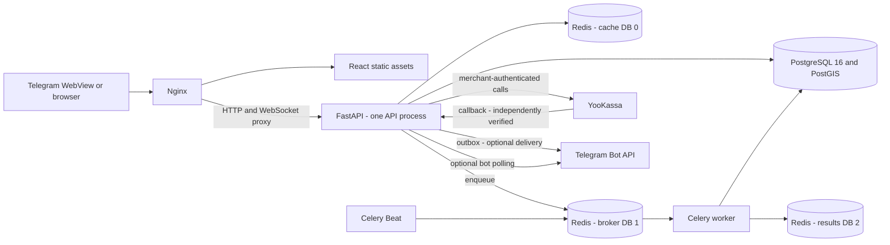
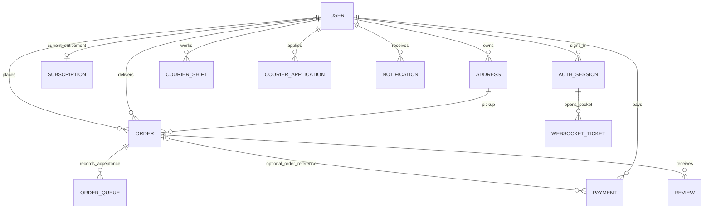
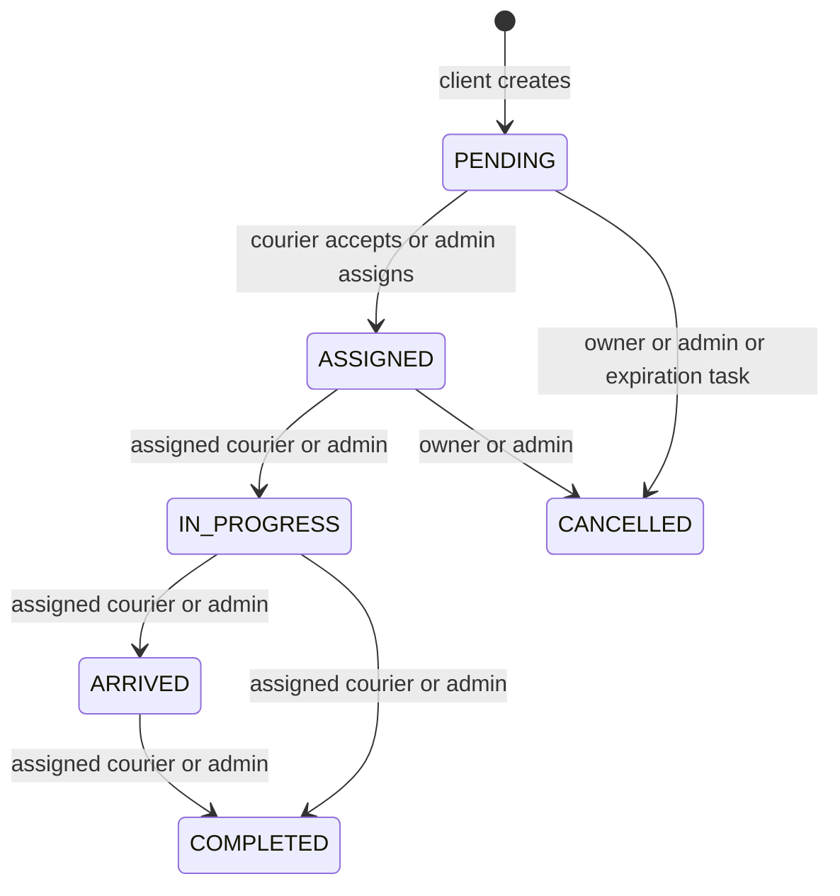
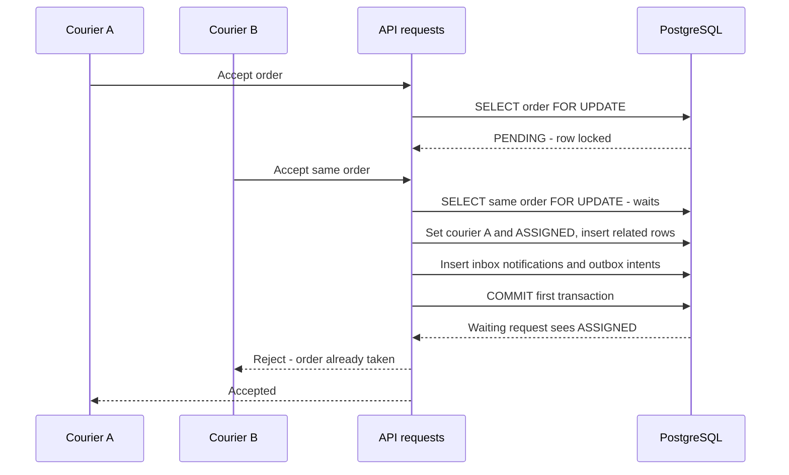

# Architecture and consistency model

EcoHaul is a **modular monolith**: one FastAPI application owns the business model,
with separate worker processes for background work. PostgreSQL is the source of truth;
Redis accelerates order discovery and transports jobs. The React client renders the
client, courier and administrator workflows without becoming a second policy engine.

The central design problem is coordinating **contested orders and external effects**:
two couriers may claim the same order, a callback may arrive twice, and a notification
may fail after a database change succeeds. The sections below distinguish database
invariants from delivery guarantees and connect both to executable evidence.

[Runtime](#1-runtime-topology) · [Domain](#2-domain-and-data-model) ·
[Concurrency](#3-order-lifecycle-and-concurrency) · [Transactions](#4-transaction-boundaries-and-failure-modes) ·
[Async I/O](#5-async-sessions-and-worker-event-loops) · [Events](#6-cache-jobs-and-realtime-delivery) ·
[Operations](#7-startup-readiness-and-operating-envelope) · [Decisions](#8-design-decisions-and-evolution)

## 1. Runtime topology

The three Redis databases are logical separation within **one Redis service**, not
independent availability domains. The API's WebSocket registry is process-local; Redis
is not currently a distributed socket event bus. Run one API worker with this topology.
Telegram polling also runs in the API lifespan when enabled and requires a single
polling owner. See [Compose](../docker/docker-compose.yml),
[application lifecycle](../backend/app/main.py) and [Celery configuration](../backend/app/celery_app.py).

### Responsibility map

| Boundary | Responsibility | Representative implementation |
| --- | --- | --- |
| HTTP transport | Pydantic input/output contracts, dependency-based authorization, response semantics | [schemas](../backend/app/schemas), [dependencies](../backend/app/api/dependencies.py) |
| Domain operations | Ownership, transitions, price rules and transaction decisions | [order handlers](../backend/app/api/v1/orders.py), [payment handlers](../backend/app/api/v1/payments.py) |
| Persistence | Relations, indexes, async session lifetime and schema evolution | [models](../backend/app/models), [database](../backend/app/core/database.py), [migrations](../backend/migrations) |
| External integrations | Merchant API, verification codes and Telegram transport | [services](../backend/app/services), [outbox dispatcher](../backend/app/services/outbox_dispatcher.py) |
| Browser transport | Bearer attachment, coordinated refresh, HTTP error mapping and socket reconnection | [API clients](../frontend/src/lib/api) |
| Presentation | Role-specific screens, shared components and local UI state | [pages](../frontend/src/pages), [store](../frontend/src/store) |

Several business operations currently remain visible in route handlers; there is
no claim that every operation passes through a repository or domain-service abstraction.
As these handlers grow, extracting command-oriented services would make transaction
ownership clearer without requiring separate network services.

## 2. Domain and data model

The main relationships below omit ancillary fields. `USER` has two distinct foreign-key
roles on an order: the client who placed it and the courier assigned to perform it.

| Rule / query | Representation and consequence |
| --- | --- |
| Order ownership and assignment | Separate `client_id` / nullable `courier_id`; UUID identity does not replace access checks |
| Pickup integrity | Address foreign key uses `RESTRICT`; address soft deletion hides it from new user operations while retaining the row |
| Financial state | Prices stored as `NUMERIC(10,2)`; checkout validates expected price on the server |
| Payment identity | Unique provider id/key and `(user_id, idempotency_key)`; settlement locks User then Payment |
| Current entitlement | Unique subscription user_id; purchases update one row and retain Payment history |
| Session revocation | AuthSession owns current refresh digest; access checks the persisted session |
| Courier work list | Composite `(courier_id, status)` index supports the matching filter |
| Client order history | `(client_id, created_at)` index aligns with owner/history access |
| Pending discovery and expiration | Status/priority and expiry indexes are declared; actual query plans still need measurement |
| Spatial data | Address points use SRID 4326; service zones use polygons and spatial indexes |

See [Order](../backend/app/models/order.py), [Payment](../backend/app/models/payment.py),
[Address](../backend/app/models/address.py) and [ServiceZone](../backend/app/models/service_zone.py).
These are schema choices, not benchmark results. Order price calculation and checkout use Decimal; response display/analytics still convert
values to floats. This is not a complete ledger or double-entry accounting system.

Current address admission uses street allowlists; configured phase bounds and stored
geometry do not establish a universal polygon-based geofence. PostGIS provides a basis
for future spatial queries, not a completed route optimizer or live GPS system.
`OrderQueue` records acceptance; its presence does not imply a mature timed-offer dispatcher.

## 3. Order lifecycle and concurrency

Creation verifies address ownership and calculates price from bag count and an applicable
active subscription. Scheduled pickups must be at least 15 minutes ahead and within the
08:00–21:00 Minsk service window. New unaccepted orders expire after 30 minutes.
The state graph is enforced by application checks; the string status column does not
contain a database constraint encoding all allowed transitions.

### Why accepting an order requires a row lock

A check-then-write without a lock permits two requests to observe `PENDING` and both
claim success. The acceptance handler instead selects the order with
`FOR UPDATE OF orders`, then checks status and expiry **inside the locked transaction**.
Courier identity and verification are checked before the mutation.

At PostgreSQL's default `READ COMMITTED` isolation, the waiting locker observes the
updated row after the first transaction commits and the handler rechecks its state.
`of=Order` targets the order rather than unnecessarily locking joined reference rows.
This is a bounded database invariant: it prevents a second claim from overwriting the
first; it does not make notifications or network responses exactly once.

Status changes, cancellation and administrator assignment also lock the order before
checking the applicable transition. Completion cannot be applied repeatedly through
the normal transition path to increment the completed-order count again.
The expiration task uses `FOR UPDATE SKIP LOCKED`: an order already being changed is
deferred to a later sweep instead of obstructing the active transaction. Acceptance
also checks expiry itself, so scheduler lag does not authorize an expired claim.

**Evidence:** [order integration tests](../backend/tests/test_orders.py) issue two
concurrent HTTP requests against real PostgreSQL, assert one accepted claim, and check
the resulting assignment. They also cover expiry, invalid transitions and cross-client
access. The locking semantics are described in
[PostgreSQL 16: explicit locking](https://www.postgresql.org/docs/16/explicit-locking.html)
and [Read Committed](https://www.postgresql.org/docs/16/transaction-iso.html#XACT-READ-COMMITTED).

## 4. Transaction boundaries and failure modes

[`get_db`](../backend/app/core/database.py) supplies a request-scoped `AsyncSession`,
commits on normal dependency exit and rolls back on failure. Some handlers commit
explicitly before that exit. A request is therefore **not universally one atomic unit**:
rollback cannot undo an earlier committed transaction or an external message.

| Operation | Durable boundary | External-effect boundary / consequence |
| --- | --- | --- |
| Create order | Order and delivery/cache intents commit together | Transport failure does not fail the committed command; unfinished delivery is retried |
| Accept one order | Locked state, assignment, inbox and outbox rows commit together | Dispatcher only sees committed intents and performs network work outside order locks |
| Advance order status | Locked transition, applicable counter and notification intents commit together | Rollback removes its events too; transport errors are handled by outbox retries |
| Create provider payment | Immutable local intent/key commit first; lease commits before provider call | Unknown result retries the same key; exhausted identity window requires review |
| Settle provider state | Lock User then Payment; effect and settlement marker commit together | Authenticated lookup precedes locks; callback and scheduled recovery share this path |
| Rotate refresh session | User/session locks; replace current token digest atomically | Replay revocation commits before returning an authentication error |
| Issue verification code | Challenge and encrypted Telegram intent commit together | Wrong-attempt budget commits before rejection; delivery is retried by outbox |

`flush()` sends statements and allocates database state inside the transaction; it is
not a durability boundary. A successful external call cannot be rolled back by SQLAlchemy.
A connection loss around `COMMIT` can also leave a caller uncertain whether a transaction
succeeded; row locking alone does not give request-level idempotency.

### Payment callbacks: identity, serialization and effect

[Payment recovery](payments.md) persists intent and frozen provider identity before external
I/O. The shared lifecycle service handles checkout retries, early callbacks and scheduled
reconciliation. A 60-second lease prevents competing recovery calls; the provider call
runs outside database locks. Unknown create outcomes reuse the same key for up to 23
hours, then require review instead of risking a second charge.

Settlement verifies identity/amount/currency/metadata, locks User before Payment, and
updates the unique current entitlement together with a settlement marker. Existing FREE
rows are reused rather than inserting another subscription for the same user. Duplicate
success cannot extend twice. Unknown callback intent returns 503 so it can be retried.
Tests inject response loss, early callbacks, concurrent checkout and local commit failure.

### Bulk commands and contention

Bulk acceptance deduplicates ids and locks in sorted UUID order. Business rejections
are reported per item, while valid claims commit together. Unexpected failures roll back
the entire batch, including inbox and outbox rows; no broad exception handler converts
a failed database transaction into a misleading partial-success response. Single and
bulk paths reuse the same acceptance helper. Further database retry policy should still
be designed before asserting immunity to every possible deadlock elsewhere in the domain.

## 5. Async sessions and worker event loops

The API uses SQLAlchemy's async engine with asyncpg. Each request gets its own session;
a session is mutable transaction state, not an object to share among concurrent requests.
`autoflush=False` makes flush points explicit and `expire_on_commit=False` avoids automatic
attribute expiry at commit; neither setting loads relationships automatically.

Order queries use eager relationship loading where response construction needs address
or user data. With async SQLAlchemy, an implicit lazy load during ordinary attribute
access can attempt I/O outside an awaited context (`MissingGreenlet`). Explicit eager
loads and refreshes keep response serialization from triggering that hidden I/O.

API connections are pooled (defaults: 5 pooled + 10 overflow per API process). Database
capacity must include every API process plus worker/task connections; increasing worker
counts is not a free throughput change.

Celery's synchronous task wrappers call `asyncio.run()` per invocation. A pooled asyncpg
connection cannot safely move from a completed event loop into the next task's loop.
Compose sets `DB_USE_NULL_POOL=True` for worker and Beat processes, so connections are
not retained across these loops. This trades connection setup cost for a simple, correct
lifetime model. [The worker regression](../backend/tests/test_worker.py) executes the
expiration task twice in separate loops. SQLAlchemy documents the same
[multiple-event-loop constraint](https://docs.sqlalchemy.org/en/20/orm/extensions/asyncio.html#using-multiple-asyncio-event-loops).

All payment creation/lookup paths share a bounded HTTP adapter executed through
`asyncio.to_thread`; connect/read timeouts are 5/10 seconds and the async wait is bounded
at 15 seconds. A timed-out await cannot revoke a request already sent to the provider,
which is why durable idempotency is required. The old parallel SDK adapters were removed.

Persistent attempt budgets use their own committed transactions. Protected callers
release read-only authentication transactions before reserving a budget, avoiding a
pool deadlock when each active request would otherwise hold one connection and wait
for another. A 20-request regression exceeds the default API pool capacity.

## 6. Cache, jobs and realtime delivery

### Discovery cache versus acceptance authority

The available-order list is cached at `orders:available` for 180 seconds. Database reads
select pending, unexpired orders ordered by priority and creation time; cached responses
also remove entries whose expiry has passed. Several order mutations invalidate the key.

Invalidation failure can leave a previously assigned order visible until refresh/TTL,
but accepting it still requires a locked database check. This separates discovery
freshness from assignment correctness. Redis errors can fail the affected request;
there is no universal fail-open database fallback in this implementation.

### Scheduled work and durable delivery

Celery Beat schedules order expiration every 300 seconds and subscription expiration
every 3,600 seconds; payment reconciliation runs every 120 seconds (20 intents per batch),
and security-record retention runs daily. Tasks use JSON serialization and create outbox rows with their
business changes. No current Beat schedule performs recurring subscription charges.
Default Celery acknowledgement semantics still apply to the scheduled task itself;
repeat sweeps revisit eligible domain rows, while committed delivery intents remain in
PostgreSQL independently of broker acknowledgement.

The API starts separate outbox loops for WebSocket, Telegram and cache work. Each claims
one committed row using `FOR UPDATE SKIP LOCKED`, performs bounded network I/O while
holding only that outbox-row lock, then records completion or retry. An unfinished earlier
row blocks later rows in its own stream, including during backoff. Other streams can
continue. The domain/outbox commit gap is closed; a crash after transport success and
before delivery commit can still produce a duplicate publication.

### WebSocket recovery and delivery boundaries

Connections open with a 30-second one-use ticket, strict browser Origin policy and
periodic session revalidation bounded by original access expiry. See the
[socket security model](security.md#7-websocket-authentication-and-connection-lifetime).
Connections remain in memory: use a single API process. The browser deduplicates recent
`event_id` values, uses persisted inbox ids and refetches authoritative HTTP state after
reconnect and on periodic visible-tab reconciliation. There is no per-device durable
replay log or distributed fan-out. Offline socket attempts complete; inbox and order state
are the recovery path. Successful transport writes do not acknowledge human receipt.

See [transactional events](events.md) for the sequence diagram, retry/ordering rules,
operator recovery/retention commands, covered producers and failure-injection tests.
[Security](security.md#7-websocket-authentication-and-connection-lifetime) describes
connection credential lifetime separately from publication semantics.

## 7. Startup, readiness and operating envelope

Compose orders startup around **usable dependencies**:

1. PostgreSQL reports TCP readiness; Redis answers `PING`.
2. The one-shot migration service runs `alembic upgrade head` against the database.
3. API and worker start after successful migrations; the API also waits for Redis.
4. Nginx starts after API readiness succeeds and serves the built SPA with HTTP/WebSocket proxying.

Using TCP in the PostgreSQL check avoids treating its temporary initialization Unix
socket as readiness for network clients. Running migrations once as a dependency avoids
competing API processes applying schema changes during startup.

`GET /health` executes a database probe and Redis `PING` with per-dependency timeouts;
it returns `503` when either dependency fails. This is dependency readiness, not a check
that Celery is consuming, the payment provider is reachable, or every business query
works. See [health implementation](../backend/app/main.py) and
[failure tests](../backend/tests/test_health.py).

The supplied stack uses one host, one API process and one Redis service. It is a
reproducible local environment, not a high-availability deployment. PostgreSQL/Redis
are not published to the host; application ports bind to loopback. Public TLS termination,
backups with restore drills and dependency-specific alerting belong to a deployment plan.
Useful future signals include oldest pending task age, lock wait time, pool saturation,
webhook verification failures and reconciliation discrepancies. No latency, throughput
or availability targets have been established by load testing.

## 8. Design decisions and evolution

| Decision | Benefit in this project | Cost / condition for revisiting |
| --- | --- | --- |
| Modular monolith with one relational database | Local transactions for contested state; straightforward debugging and schema evolution | Handler growth calls for explicit application services before distributed boundaries |
| Pessimistic row locking for claims | Clear winner under contention; state checked while protected | Hold locks briefly; define deadlock retry and bulk ordering policy |
| Async API and background workers | Request I/O and delayed work have different lifetimes | Async does not remove external latency, broker failure or connection limits |
| PostgreSQL plus Redis cache | Durable authority and faster repeated discovery are distinct | Cache invalidation may lag; Redis currently shares cache and broker failure impact |
| Transactional outbox | Domain state and delivery intent commit atomically; retries survive process restart | Duplicate publications remain possible; monitor backlog and retain/clean payloads deliberately |
| In-memory WebSocket registry | Simple direct delivery in a single API process | Distributed fan-out and connection ownership are prerequisites to multiple API workers |
| Provider state fetched before settlement | Forged request bodies cannot directly grant entitlements | Provider availability affects callbacks; reconciliation must cover local/provider gaps |
| PostGIS-backed locations | Typed spatial storage with room for spatial querying | Actual geofencing/routing requires implemented policies, queries and measurements |

Checkout recovery and session state now have explicit application services. Next steps
are distributed socket ownership/fan-out, deployment observability, measured query/pool
capacity, and additional domain-service extraction where route complexity justifies it.
Do not split the monolith before identifying a boundary that benefits from distribution.
Every stronger guarantee should have an associated failure-path test.

## 9. Verification map

| Architectural claim | Executable evidence | Scope |
| --- | --- | --- |
| Concurrent claims cannot both assign one order | [test_orders.py](../backend/tests/test_orders.py) | Concurrent HTTP requests against real PostgreSQL |
| Rolled-back commands publish nothing; stream order survives retries | [test_outbox.py](../backend/tests/test_outbox.py) | Real PostgreSQL, injected failures and concurrent dispatchers |
| Repeated settlement does not repeat the same payment effect | [test_webhooks.py](../backend/tests/test_webhooks.py) | Real database, controlled provider responses |
| Lost provider response preserves checkout identity | [test_checkout.py](../backend/tests/test_checkout.py) | Real PostgreSQL, controlled provider and injected failures |
| Refresh replay revokes the session family | [test_sessions.py](../backend/tests/test_sessions.py) | Persisted session and concurrent attempt-budget tests |
| Worker connections do not cross invocation loops | [test_worker.py](../backend/tests/test_worker.py) | Repeated task execution with separate event loops |
| Dependency failure changes readiness | [test_health.py](../backend/tests/test_health.py) | Controlled DB/Redis failure probes |
| Fresh schema and production imports work | [CI workflow](../.github/workflows/ci.yml) | Fresh migration database; backend image without dev dependencies |
| Browser application compiles against its contracts | [CI workflow](../.github/workflows/ci.yml) | TypeScript build, ESLint and production-dependency audit |

Integration tests use PostgreSQL/PostGIS and Redis, while Telegram/provider delivery is
mocked. They validate selected invariants, not load capacity, exhaustive endpoint coverage
or production resilience. For reproducible commands and isolated test services, see
[development](development.md); for trust boundaries and permission details, see
[security](security.md).
