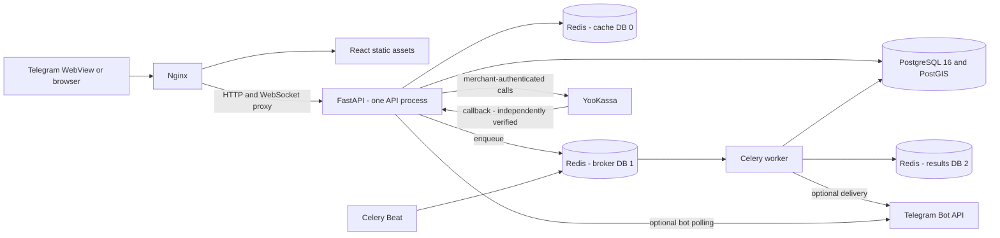
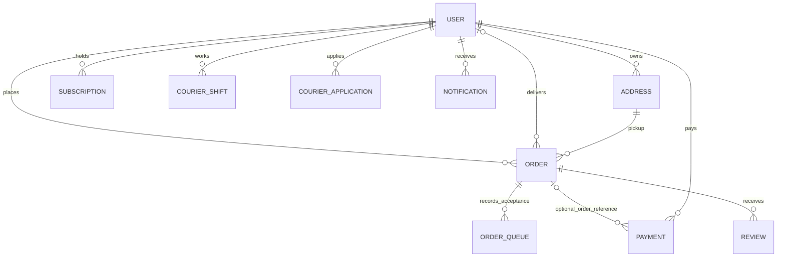
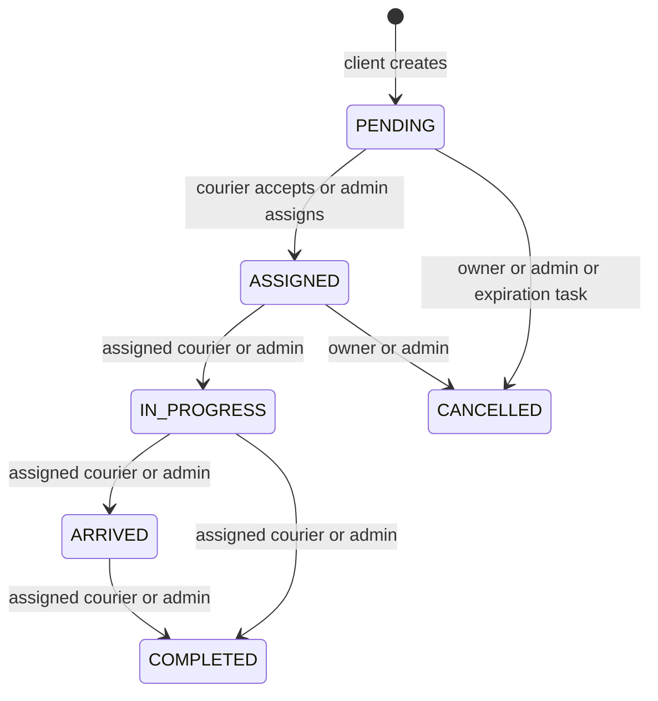
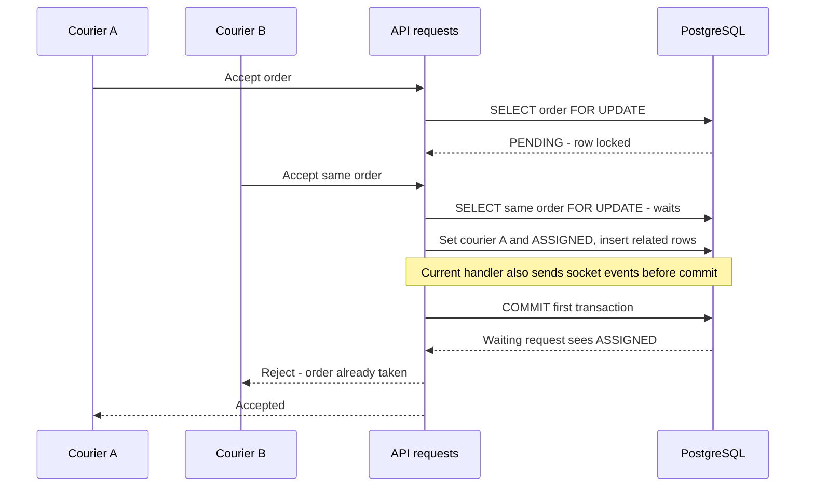

# Architecture and consistency model

EcoHaul is a **modular monolith**: one FastAPI application owns the business model,
with separate worker processes for background work. PostgreSQL is the source of truth;
Redis accelerates order discovery and transports jobs. The React client renders the
client, courier and administrator workflows without becoming a second policy engine.

The central design problem is coordinating **contested orders and external effects**:
two couriers may claim the same order, a callback may arrive twice, and a notification
may fail after a database change succeeds. The sections below distinguish database
invariants from delivery guarantees and connect both to executable evidence.

[Runtime](#1-runtime-topology) · [Domain](#2-domain-and-data-model) ·
[Concurrency](#3-order-lifecycle-and-concurrency) · [Transactions](#4-transaction-boundaries-and-failure-modes) ·
[Async I/O](#5-async-sessions-and-worker-event-loops) · [Events](#6-cache-jobs-and-realtime-delivery) ·
[Operations](#7-startup-readiness-and-operating-envelope) · [Decisions](#8-design-decisions-and-evolution)

## 1. Runtime topology



The three Redis databases are logical separation within **one Redis service**, not
independent availability domains. The API's WebSocket registry is process-local; Redis
is not currently a distributed socket event bus. Run one API worker with this topology.
Telegram polling also runs in the API lifespan when enabled and requires a single
polling owner. See [Compose](../docker/docker-compose.yml),
[application lifecycle](../backend/app/main.py) and [Celery configuration](../backend/app/celery_app.py).

### Responsibility map

| Boundary | Responsibility | Representative implementation |
| --- | --- | --- |
| HTTP transport | Pydantic input/output contracts, dependency-based authorization, response semantics | [schemas](../backend/app/schemas), [dependencies](../backend/app/api/dependencies.py) |
| Domain operations | Ownership, transitions, price rules and transaction decisions | [order handlers](../backend/app/api/v1/orders.py), [payment handlers](../backend/app/api/v1/payments.py) |
| Persistence | Relations, indexes, async session lifetime and schema evolution | [models](../backend/app/models), [database](../backend/app/core/database.py), [migrations](../backend/migrations) |
| External integrations | Merchant API, verification codes and Telegram transport | [services](../backend/app/services), [notification tasks](../backend/app/tasks/notifications.py) |
| Browser transport | Bearer attachment, coordinated refresh, HTTP error mapping and socket reconnection | [API clients](../frontend/src/lib/api) |
| Presentation | Role-specific screens, shared components and local UI state | [pages](../frontend/src/pages), [store](../frontend/src/store) |

Several business operations currently remain visible in route handlers; there is
no claim that every operation passes through a repository or domain-service abstraction.
As these handlers grow, extracting command-oriented services would make transaction
ownership clearer without requiring separate network services.

## 2. Domain and data model

The main relationships below omit ancillary fields. `USER` has two distinct foreign-key
roles on an order: the client who placed it and the courier assigned to perform it.



| Rule / query | Representation and consequence |
| --- | --- |
| Order ownership and assignment | Separate `client_id` / nullable `courier_id`; UUID identity does not replace access checks |
| Pickup integrity | Address foreign key uses `RESTRICT`; address soft deletion hides it from new user operations while retaining the row |
| Financial state | Prices stored as `NUMERIC(10,2)`; checkout validates expected price on the server |
| Duplicate provider identity | Unique provider payment id; settlement additionally locks the local payment |
| Courier work list | Composite `(courier_id, status)` index supports the matching filter |
| Client order history | `(client_id, created_at)` index aligns with owner/history access |
| Pending discovery and expiration | Status/priority and expiry indexes are declared; actual query plans still need measurement |
| Spatial data | Address points use SRID 4326; service zones use polygons and spatial indexes |

See [Order](../backend/app/models/order.py), [Payment](../backend/app/models/payment.py),
[Address](../backend/app/models/address.py) and [ServiceZone](../backend/app/models/service_zone.py).
These are schema choices, not benchmark results. Monetary request/calculation paths
still contain floats, so exact storage alone is not an end-to-end Decimal accounting model.

Current address admission uses street allowlists; configured phase bounds and stored
geometry do not establish a universal polygon-based geofence. PostGIS provides a basis
for future spatial queries, not a completed route optimizer or live GPS system.
`OrderQueue` records acceptance; its presence does not imply a mature timed-offer dispatcher.

## 3. Order lifecycle and concurrency



Creation verifies address ownership and calculates price from bag count and an applicable
active subscription. Scheduled pickups must be at least 15 minutes ahead and within the
08:00–21:00 Minsk service window. New unaccepted orders expire after 30 minutes.
The state graph is enforced by application checks; the string status column does not
contain a database constraint encoding all allowed transitions.

### Why accepting an order requires a row lock

A check-then-write without a lock permits two requests to observe `PENDING` and both
claim success. The acceptance handler instead selects the order with
`FOR UPDATE OF orders`, then checks status and expiry **inside the locked transaction**.
Courier identity and verification are checked before the mutation.



At PostgreSQL's default `READ COMMITTED` isolation, the waiting locker observes the
updated row after the first transaction commits and the handler rechecks its state.
`of=Order` targets the order rather than unnecessarily locking joined reference rows.
This is a bounded database invariant: it prevents a second claim from overwriting the
first; it does not make notifications or network responses exactly once.

Status changes, cancellation and administrator assignment also lock the order before
checking the applicable transition. Completion cannot be applied repeatedly through
the normal transition path to increment the completed-order count again.
The expiration task uses `FOR UPDATE SKIP LOCKED`: an order already being changed is
deferred to a later sweep instead of obstructing the active transaction. Acceptance
also checks expiry itself, so scheduler lag does not authorize an expired claim.

**Evidence:** [order integration tests](../backend/tests/test_orders.py) issue two
concurrent HTTP requests against real PostgreSQL, assert one accepted claim, and check
the resulting assignment. They also cover expiry, invalid transitions and cross-client
access. The locking semantics are described in
[PostgreSQL 16: explicit locking](https://www.postgresql.org/docs/16/explicit-locking.html)
and [Read Committed](https://www.postgresql.org/docs/16/transaction-iso.html#XACT-READ-COMMITTED).

## 4. Transaction boundaries and failure modes

[`get_db`](../backend/app/core/database.py) supplies a request-scoped `AsyncSession`,
commits on normal dependency exit and rolls back on failure. Some handlers commit
explicitly before that exit. A request is therefore **not universally one atomic unit**:
rollback cannot undo an earlier committed transaction or an external message.

| Operation | Durable boundary | External-effect boundary / consequence |
| --- | --- | --- |
| Create order | Order is explicitly committed before delivery/cache work | A later enqueue or Redis failure can fail the HTTP request after the order exists; blind retry can create another order |
| Accept one order | Locked state, assignment and related rows are committed together | Socket events precede commit; Telegram enqueue and cache invalidation follow it |
| Advance order status | Locked transition and counters are committed in the handler | Socket/task effects can occur before commit and survive a later rollback |
| Create provider payment | Local row is flushed; provider is called; provider id is saved and committed | Provider creation and local persistence cannot share a PostgreSQL transaction |
| Settle payment callback | Verified payment is locked; payment and applicable subscription effect commit together | Provider lookup occurs first; crash/early-callback races still need reconciliation |

`flush()` sends statements and allocates database state inside the transaction; it is
not a durability boundary. A successful external call cannot be rolled back by SQLAlchemy.
A connection loss around `COMMIT` can also leave a caller uncertain whether a transaction
succeeded; row locking alone does not give request-level idempotency.

### Payment callbacks: identity, serialization and effect

The webhook handler fetches authoritative state from the merchant API, verifies its id,
status, amount, currency and local metadata, then locks the local payment. A non-`PENDING`
record is acknowledged without repeating its effect. For subscription settlement the
handler additionally locks the user before replacing that user's active subscription.
This serializes this handler's entitlement changes; it is not a schema-wide guarantee
that every subscription-writing route enforces the same invariant.

The provider id is unique, but checkout does not persist a request idempotency key across
HTTP retries. Unknown local callback records are acknowledged rather than retained for
later processing. Reliable recovery would require persisted checkout intent and provider
reconciliation, not simply more webhook retries. See the full
[payment trust model](security.md#6-payment-integrity-and-idempotency) and
[callback tests](../backend/tests/test_webhooks.py).

### Bulk commands and contention

Bulk acceptance locks orders within one request/session. It does not use one independent
transaction or savepoint per item, so catching an item exception does not establish
isolated partial-success rollback. Locking overlapping sets in different orders can also
introduce deadlocks. Canonical lock ordering, a defined batch atomicity contract and
bounded retries for retryable database errors are useful next steps before expanding
this workflow. Keep external I/O outside locks when extracting transaction services.

## 5. Async sessions and worker event loops

The API uses SQLAlchemy's async engine with asyncpg. Each request gets its own session;
a session is mutable transaction state, not an object to share among concurrent requests.
`autoflush=False` makes flush points explicit and `expire_on_commit=False` avoids automatic
attribute expiry at commit; neither setting loads relationships automatically.

Order queries use eager relationship loading where response construction needs address
or user data. With async SQLAlchemy, an implicit lazy load during ordinary attribute
access can attempt I/O outside an awaited context (`MissingGreenlet`). Explicit eager
loads and refreshes keep response serialization from triggering that hidden I/O.

API connections are pooled (defaults: 5 pooled + 10 overflow per API process). Database
capacity must include every API process plus worker/task connections; increasing worker
counts is not a free throughput change.

Celery's synchronous task wrappers call `asyncio.run()` per invocation. A pooled asyncpg
connection cannot safely move from a completed event loop into the next task's loop.
Compose sets `DB_USE_NULL_POOL=True` for worker and Beat processes, so connections are
not retained across these loops. This trades connection setup cost for a simple, correct
lifetime model. [The worker regression](../backend/tests/test_worker.py) executes the
expiration task twice in separate loops. SQLAlchemy documents the same
[multiple-event-loop constraint](https://docs.sqlalchemy.org/en/20/orm/extensions/asyncio.html#using-multiple-asyncio-event-loops).

In the checkout/webhook paths, synchronous merchant SDK calls are wrapped with
`asyncio.to_thread`. This avoids blocking those async handlers; it does not make the SDK
transactional or remove provider latency. Other subscription integration paths still
contain synchronous SDK work and would need the same audit before claiming nonblocking
external I/O throughout the application.

## 6. Cache, jobs and realtime delivery

### Discovery cache versus acceptance authority

The available-order list is cached at `orders:available` for 180 seconds. Database reads
select pending, unexpired orders ordered by priority and creation time; cached responses
also remove entries whose expiry has passed. Several order mutations invalidate the key.

Invalidation failure can leave a previously assigned order visible until refresh/TTL,
but accepting it still requires a locked database check. This separates discovery
freshness from assignment correctness. Redis errors can fail the affected request;
there is no universal fail-open database fallback in this implementation.

### Scheduled work and retry semantics

Celery Beat schedules order expiration every 300 seconds and subscription expiration
every 3,600 seconds. The current schedule does not perform recurring subscription charges.
Tasks use JSON serialization. Notification delivery is optional; when enabled, transient
errors retry up to three times with a 60-second delay. Telegram `BadRequest` / `Forbidden`
errors are logged without retry because repeating the same request is generally unhelpful.

No late-acknowledgement policy is configured. Celery's default early acknowledgement
means a worker failure can lose already acknowledged work. Explicit task retries handle
selected exceptions, not every crash window. The project therefore does not claim
at-least-once or exactly-once end-to-end execution. See
[Celery task acknowledgement semantics](https://docs.celeryq.dev/en/stable/userguide/tasks.html).

### WebSockets and the outbox boundary

Connections are authenticated at handshake and indexed by user id in an in-memory
manager. The browser reconnects with bounded backoff, but there is no persistent event
cursor, replay stream or cross-process fan-out. Reconnection is a reason to refresh
current state through HTTP, not proof that every intervening event was received.
[Security](security.md#7-websocket-authentication-and-connection-lifetime) explains
credential lifetime and Origin considerations separately from delivery semantics.

A transactional outbox would close the current database/message gap:

```text
Proposed, not implemented:
  command transaction: lock + update domain rows + insert outbox event + commit
  dispatcher: claim pending events + publish + record outcome / retry
  consumer: deduplicate by stable event id
```

An outbox makes publication recoverable after commit; it still needs idempotent consumers
because publishing and marking an event delivered have their own crash window. Redis
Pub/Sub alone would enable fan-out, not durable replay or recovery.

## 7. Startup, readiness and operating envelope

Compose orders startup around **usable dependencies**:

1. PostgreSQL reports TCP readiness; Redis answers `PING`.
2. The one-shot migration service runs `alembic upgrade head` against the database.
3. API and worker start after successful migrations; the API also waits for Redis.
4. Nginx starts after API readiness succeeds and serves the built SPA with HTTP/WebSocket proxying.

Using TCP in the PostgreSQL check avoids treating its temporary initialization Unix
socket as readiness for network clients. Running migrations once as a dependency avoids
competing API processes applying schema changes during startup.

`GET /health` executes a database probe and Redis `PING` with per-dependency timeouts;
it returns `503` when either dependency fails. This is dependency readiness, not a check
that Celery is consuming, the payment provider is reachable, or every business query
works. See [health implementation](../backend/app/main.py) and
[failure tests](../backend/tests/test_health.py).

The supplied stack uses one host, one API process and one Redis service. It is a
reproducible local environment, not a high-availability deployment. PostgreSQL/Redis
are not published to the host; application ports bind to loopback. Public TLS termination,
backups with restore drills and dependency-specific alerting belong to a deployment plan.
Useful future signals include oldest pending task age, lock wait time, pool saturation,
webhook verification failures and reconciliation discrepancies. No latency, throughput
or availability targets have been established by load testing.

## 8. Design decisions and evolution

| Decision | Benefit in this project | Cost / condition for revisiting |
| --- | --- | --- |
| Modular monolith with one relational database | Local transactions for contested state; straightforward debugging and schema evolution | Handler growth calls for explicit application services before distributed boundaries |
| Pessimistic row locking for claims | Clear winner under contention; state checked while protected | Hold locks briefly; define deadlock retry and bulk ordering policy |
| Async API and background workers | Request I/O and delayed work have different lifetimes | Async does not remove synchronous SDK work, broker failure or connection limits |
| PostgreSQL plus Redis cache | Durable authority and faster repeated discovery are distinct | Cache invalidation may lag; Redis currently shares cache and broker failure impact |
| In-memory WebSocket registry | Simple direct delivery in a single API process | Distributed fan-out and connection ownership are prerequisites to multiple API workers |
| Provider state fetched before settlement | Forged request bodies cannot directly grant entitlements | Provider availability affects callbacks; reconciliation must cover local/provider gaps |
| PostGIS-backed locations | Typed spatial storage with room for spatial querying | Actual geofencing/routing requires implemented policies, queries and measurements |

A sensible evolution order is: extract transaction-oriented command services; add
persisted request idempotency and an outbox; implement payment reconciliation and
session revocation; then add distributed fan-out and measure bottlenecks before scaling.
Each step changes an observable guarantee and should gain a matching failure-path test.

## 9. Verification map

| Architectural claim | Executable evidence | Scope |
| --- | --- | --- |
| Concurrent claims cannot both assign one order | [test_orders.py](../backend/tests/test_orders.py) | Concurrent HTTP requests against real PostgreSQL |
| Repeated settlement does not repeat the same payment effect | [test_webhooks.py](../backend/tests/test_webhooks.py) | Real database, controlled provider responses |
| Worker connections do not cross invocation loops | [test_worker.py](../backend/tests/test_worker.py) | Repeated task execution with separate event loops |
| Dependency failure changes readiness | [test_health.py](../backend/tests/test_health.py) | Controlled DB/Redis failure probes |
| Fresh schema and production imports work | [CI workflow](../.github/workflows/ci.yml) | Fresh migration database; backend image without dev dependencies |
| Browser application compiles against its contracts | [CI workflow](../.github/workflows/ci.yml) | TypeScript build, ESLint and production-dependency audit |

Integration tests use PostgreSQL/PostGIS and Redis, while Telegram/provider delivery is
mocked. They validate selected invariants, not load capacity, exhaustive endpoint coverage
or production resilience. For reproducible commands and isolated test services, see
[development](development.md); for trust boundaries and permission details, see
[security](security.md).
