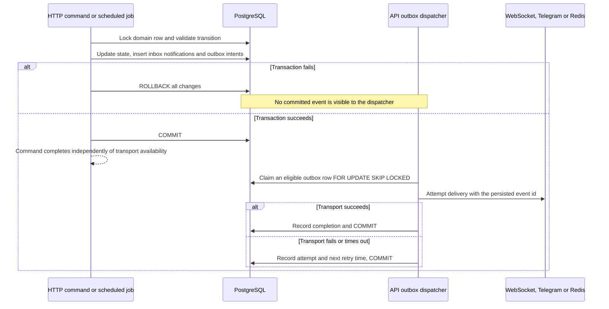

# Transactional events and delivery recovery

EcoHaul persists delivery intent in PostgreSQL **in the same transaction as the domain
change**. API handlers and expiration jobs do not send WebSocket messages, call Telegram,
or invalidate Redis directly while changing an order. This closes the gap between
saving business state and remembering the external work it requires.

The implementation fits the current single-API-process deployment. It provides durable
intents and retryable processing, not exactly-once end-user delivery.

## 1. From command to delivery



**Producer rule:** queue helpers only add rows to the caller's session. They never
commit or start network I/O. If insertion fails, the business transaction fails with it.
If the API exits after commit but before delivery, the row remains available to the next
process. Database visibility provides the publication boundary; an in-memory
`after_commit` callback would still lose work when a process exits before running it.

Implementation: [producer helpers](../backend/app/services/outbox.py),
[order inbox/events](../backend/app/services/order_events.py),
[dispatcher](../backend/app/services/outbox_dispatcher.py),
[model](../backend/app/models/outbox.py), [migration](../backend/migrations/versions/b47a2f019e60_add_transactional_outbox.py).

## 2. What is stored and how ordering works

| Field | Purpose |
| --- | --- |
| `sequence` | PostgreSQL identity used to order rows; gaps from rollbacks are harmless |
| `event_id` | Stable UUID reused on every publication attempt |
| `channel` | Independently processed `websocket`, `telegram` or `cache` work |
| `stream` | Ordering key; order notifications include order identity and recipient |
| `payload` | JSON-encoded immutable delivery snapshot; never raw JWTs or bot credentials |
| `available_at`, `attempts`, `last_error` | Persistent retry schedule and diagnosis |
| `delivered_at` | Completed channel processing; not an acknowledgement that a human read the message |
| `discarded_at`, `discard_reason` | Explicit operator decision to abandon an undeliverable intent |

For the same `(channel, stream)`, a row is eligible only when no earlier unfinished row
exists. The earlier-row condition applies even during backoff or while another dispatcher
holds its lock. Merely using `SKIP LOCKED` without that condition would let a later
`COMPLETED` event overtake a failing `IN_PROGRESS` event.

Order writers hold the order lock while producing intents, so competing transitions
on that order serialize before their event rows are committed. The sequence is not a
global commit clock: independently written aggregates have no cross-aggregate ordering
contract. WebSocket and Telegram streams also do not share a delivery clock.

The claim transaction locks **only the outbox row**, not the order or user. Its external
I/O has a 10-second timeout. Partial indexes cover ready work and unfinished stream
predecessors; these are query-design choices, not load-test results.

## 3. Retries, crashes and duplicate publications

Three dispatcher loops start with the API lifespan, one per channel. Idle loops poll
every second. Delivery failure schedules exponential backoff of 2, 4, 8, ... seconds,
capped at 300 seconds. Failure in one stream does not stop unrelated streams or channels.
Database failure is logged and retried; shutdown cancels dispatchers before closing
Redis and the database engine.

Only the exception class is retained/logged for delivery failures. Provider exception
bodies can contain private message text or credential-bearing URLs and are not copied
into `last_error`.

| Failure window | Result |
| --- | --- |
| Domain/outbox transaction rolls back | Neither its state change nor its event is committed |
| Process exits after domain commit | The unfinished row is still claimable after restart |
| Transport rejects the attempt | Row remains pending with backoff and diagnostic metadata |
| Process exits during transport I/O | Delivery transaction rolls back; the row can be attempted again |
| Transport succeeds but delivery commit is lost | The same event can be published again with the same `event_id` |
| A particular stream cannot be delivered | It remains visible for operational review; later rows of that stream wait |

The last two cases rule out an exactly-once claim. Telegram does not consume our event
id as a deduplication key, so a user can receive a duplicate message after an ambiguous
network/commit outcome. A permanent rejection is retained rather than silently treated
as success; an operator can deliberately discard it with a recorded reason.

## 4. Browser recovery and inbox semantics

WebSocket events are realtime hints. The in-memory connection registry remains local to
one API process. A channel attempt with no connected recipient completes without waiting
for that person to reconnect; the outbox is **not a per-device replay log**. Successful
socket writes also do not prove receipt or display by a browser.

Assignment and order-status notifications are stored in the user's inbox in the same
transaction as the order. On `CONNECTED`, after returning to the visible tab, and during
periodic reconciliation, the browser reloads the inbox through authenticated HTTP.
Order views refresh through HTTP on relevant events, reconnect, visibility changes and
a visible-tab 30-second fallback. Pending-discovery cache freshness remains a separate
bounded-staleness concern.

The [WebSocket client](../frontend/src/lib/api/websocket.ts) suppresses duplicate event
ids using a bounded set of the most recent 1,024 ids for that JavaScript instance. This
survives socket reconnects in the same page, not full reloads or arbitrary old replays.
Stale sockets cannot invoke handlers after being replaced.

Persisted inbox ids are carried in assignment/status payloads. The
[notification store](../frontend/src/store/notifications.store.ts) deduplicates by those
ids and reconciles HTTP snapshots with events that arrive while a request is in flight.
Read state is monotonic locally; clearing the inbox invalidates older in-flight snapshots.
The bell records read state on the server rather than only clearing a local badge.
Before publishing a persisted inbox hint, the dispatcher checks that its inbox entry
still exists for that recipient. Entries already deleted before the attempt are skipped.

If a socket write fails, the connection manager unregisters and closes that socket so
the client can reconnect. A partially successful fan-out is retried with the same event
id; already updated tabs can suppress its duplicate.

## 5. Covered producers and batch behavior

| Producer | Changes committed with delivery intent |
| --- | --- |
| New order | Order plus courier discovery events, optional Telegram confirmation and cache invalidation |
| Courier acceptance / administrator assignment | Assignment, acceptance record, both recipient inbox entries, realtime/Telegram intent and cache invalidation |
| Status progression | Transition, applicable counter change and persistent status notifications |
| User/administrator cancellation | Cancellation, affected-recipient status notifications and cache invalidation |
| Expiration worker | Locked cancellation, client inbox/realtime/Telegram intent and cache invalidation |
| Courier application review | Review/role changes and optional Telegram decision notification |
| Shift end | Shift state and realtime summary |
| Administrative scheduled commands | Their persisted notifications and realtime intent |

Bulk acceptance deduplicates input ids and acquires locks in sorted UUID order.
Expected business rejections are returned per item; valid claims share one transaction.
An unexpected database/application failure rolls back the whole batch, including all
accepted claims and all their events. It is not a collection of independent savepoints.
Both single and bulk acceptance reuse the same mutation/notification helper.

With `TELEGRAM_ENABLED=False`, producers do not create new Telegram intents and the
Telegram dispatcher pauses any existing ones. This prevents a local/demo session from
accumulating real outbound messages to send on a later configuration change.

## 6. Inspecting and recovering work

The operator utility works through a configured backend environment. It prints ids,
counts, retry metadata and error classes, **not payloads or credentials**. In Compose:

```sh
# Pending count, oldest intent, maximum attempts and up to 20 oldest event ids
docker compose --env-file .env -f docker/docker-compose.yml exec backend python scripts/outbox.py status

# Make a pending event eligible now; keeps its event id and attempt history
docker compose --env-file .env -f docker/docker-compose.yml exec backend python scripts/outbox.py retry EVENT_UUID

# Explicitly abandon an undeliverable intent after investigating the failure
docker compose --env-file .env -f docker/docker-compose.yml exec backend python scripts/outbox.py discard EVENT_UUID --reason "Recipient permanently unavailable"

# Retention maintenance: removes only terminal rows older than seven days
docker compose --env-file .env -f docker/docker-compose.yml exec backend python scripts/outbox.py purge --days 7
```

The tool never replays a terminal row. Retry cannot bypass an earlier pending stream
head; inspect that head first. Discard records abandonment, not successful delivery, and
allows later events to proceed. `purge` preserves every pending intent, regardless of age.
Schedule retention maintenance explicitly: no automatic purge is claimed by this stack.
Outbox payloads can contain addresses/contacts and need the same backup/access/retention
policy as the domain database.

Alerting should consider oldest pending age, attempts, dispatcher errors and per-channel
backlog. `/health` still probes DB/Redis dependency readiness; it is not an outbox-lag or
external-provider health check. A missing/paused API dispatcher leaves intents pending.

## 7. Regression evidence and remaining boundaries

[PostgreSQL integration tests](../backend/tests/test_outbox.py) cover uncommitted
visibility, rollback, restart through a fresh dispatcher session, duplicate publication
identity, timeout/backoff, head-of-stream locking, unrelated-stream progress, producer
commit failures, batch rollback, administrator assignment and inbox recovery over HTTP.
[Transport/lifecycle tests](../backend/tests/test_event_transport.py) cover partial socket
failure, dispatcher recovery and shutdown ordering. [Browser-module tests](../frontend/tests/events.test.mjs)
exercise duplicate suppression, stale-socket rejection and inbox snapshot races.
[The live transport test](../backend/tests/test_live_events.py) starts the real API
on localhost and checks committed assignment delivery plus `MARK_READ` recovery over HTTP.
External Telegram sends are replaced in tests; no real recipient is contacted.

The outbox does not provide distributed WebSocket routing or durable browser
acknowledgements. [Checkout idempotency/reconciliation](payments.md) and
[session revocation](security.md#3-jwt-lifecycle-and-browser-session-behavior) are separate
implemented protocols with their own failure models. Scaling beyond one API process
requires explicit connection ownership/fan-out; running several generic dispatchers
against process-local registries could consume an event on the wrong process.

Verification-code delivery uses encrypted outbox text and a challenge id. The dispatcher
skips used/expired/superseded challenges before transport; plaintext codes are not stored
in the delivery snapshot. See [challenge protection](security.md#5-passwords-and-verification-codes).
