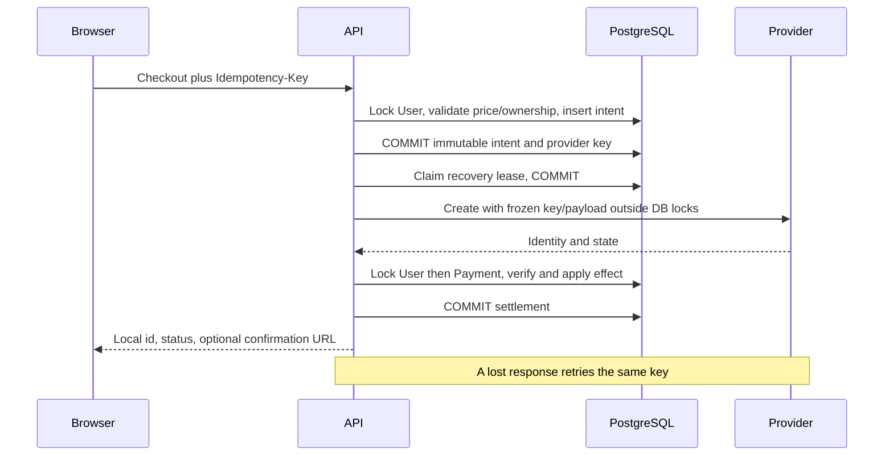

# Payment consistency and recovery

The difficult case is an uncertain result: a provider creates a payment, but its response
is lost or local persistence fails. A new provider key could charge twice; cancellation
by timeout could hide a successful charge. EcoHaul persists intent first and keeps that
uncertainty explicit until verified provider state resolves it.

Implementation: [lifecycle](../backend/app/services/payment_lifecycle.py),
[REST adapter](../backend/app/services/yookassa_service.py),
[routes](../backend/app/api/v1/payments.py), [recovery migration](../backend/migrations/versions/c6a209e741db_add_payment_recovery.py).

## 1. Identity and transaction protocol

| Identity | Responsibility |
| --- | --- |
| Local payment.id | Durable intent, included in provider metadata and return URL |
| HTTP Idempotency-Key | Caller UUID, unique with user_id and bound to a canonical request hash |
| provider_key | Persisted server UUID, reused with the exact frozen provider request |



Amounts use Decimal with two-decimal rounding. Checkout validates server-derived prices,
order ownership and completed-order eligibility. The frozen request includes amount,
currency, description, return URL, metadata and saved-method choice. A later price change
does not mutate an existing provider request. Same HTTP key with changed input returns
409. A separate pending/completed payment for the same order blocks a new checkout key.
Subscription purchases with different keys are separate intentions and can extend access.

A 60-second persisted lease prevents competing recovery calls from creating in parallel.
The lease commits before network I/O; a crash leaves it to expire. REST calls run in a
thread with 5-second connect and 10-second read timeouts, bounded by a 15-second async
wait. Cancelling an await cannot undo a provider request; stable identity provides safety.

YooKassa documents same-key/same-request retries and a 24-hour idempotency period; a
server error can leave the result unknown. EcoHaul uses a conservative **23-hour create
retry deadline from local intent creation**. Known provider identities are fetched,
never created again. See the [provider interaction contract](https://yookassa.ru/developers/using-api/interaction-format).

## 2. Outcome and recovery state

| Field | Meaning |
| --- | --- |
| status | PENDING, COMPLETED, CANCELLED, FAILED: verified outcome or explicit creation rejection |
| creation_state | NEW, READY, REVIEW, FAILED, LEGACY: whether recovery can continue |
| next_reconcile_at / reconcile_attempts | Durable retry schedule, 2–300 second backoff |
| settlement_applied_at | Marker committed atomically with entitlement effect |
| checkout_expires_at | Local 15-minute guidance; does not cancel a provider payment |

REVIEW means uncertainty or unsupported state requiring inspection, not a failed charge.
Examples: unknown identity beyond retry deadline, metadata mismatch, waiting-for-capture,
or pending without a usable confirmation URL. Selected explicit creation 4xx responses
can fail the intent; timeout and 5xx remain pending. Only authenticated provider success
grants access; only verified provider cancellation cancels an existing payment. Error
records retain exception classes, not raw merchant bodies/credentials. The saved provider
snapshot contains only id/status/amount/currency. Confirmation URLs must be HTTPS without
userinfo.

## 3. Callback verification and entitlement

Callback JSON prompts a merchant-authenticated lookup. The handler checks requested id,
event/status agreement, amount, currency, local user/payment ids and all frozen metadata.
Early callbacks locate the committed intent via verified provider metadata, even before
the create response is saved. Missing local intent returns 503 for retry, provider lookup
failure returns 502, and mismatches return 409. Unsupported events have no financial effect.

Settlement locks User before Payment and refreshes the locked record. Payment status,
settlement marker and subscription update commit together. Concurrent callbacks/recovery
serialize; duplicate success cannot grant twice, even if only the local status field was
accidentally changed. Verified cancellation cannot downgrade settled money. Refunds need
a separate workflow and are not implemented as a status downgrade.

One unique subscription row per user represents current entitlement; payment rows retain
purchase history. Existing FREE/expired rows are reused, avoiding the old unique-user
conflict. The same active tier extends from its current end; expired/different tiers start
at settlement. One purchased month means **30 days**, for 1–12 months. Tier changes do not
prorate remaining value. A saved card is not recurring billing: auto-renew stays false,
the enable endpoint returns 409, and scheduled renewal cannot grant unpaid time.

## 4. Failure matrix

| Failure point | Recovery and invariant |
| --- | --- |
| Before intent commit | No provider call; retry original HTTP key |
| After intent commit, before create | Reconciler can submit the saved key/payload |
| Create response lost | Pending; exact key/payload retry inside deadline |
| Early callback beats create response | Verified metadata links the already committed intent |
| Local settlement transaction fails | No partial entitlement grant; retry in a fresh transaction |
| Duplicate callback / concurrent reconciler | Row locks plus settlement marker prevent repeated effect |
| Callback never arrives | Scheduled lookup of the known provider id can settle |
| Unknown id beyond retry deadline | REVIEW; no blind new charge |
| Worker/Beat/broker unavailable | PostgreSQL intent survives; recovery is delayed |

These are local transaction and retry guarantees, not distributed exactly-once delivery.

## 5. HTTP behavior and operator recovery

POST /payments and /subscriptions/purchase require a UUID Idempotency-Key. Normally they
return 201; pending without a confirmation URL returns 202 and Retry-After: 2. The browser
coalesces concurrent clicks and retains retry identity in sessionStorage by user, endpoint
and request, surviving network failure/reload. Its retries are bounded. Changed-input key
reuse and conflicting order payment return 409. Disabled payment work returns 503.
Owner-scoped GET /payments/{id} exposes durable status. Redirect to the success page is
not evidence of payment: it polls server state and displays success only for COMPLETED.

Celery Beat reconciles every 120 seconds in batches of 20, honoring lease/backoff and
skipping REVIEW. Monitor pending age, retry count, REVIEW/mismatch count and worker health.
/health probes DB/Redis, not reconciliation lag. Without worker/Beat there is no scheduled
recovery, although HTTP retries and verified callbacks still operate.

Administrator-only recovery:

```http
POST /api/v1/admin/payments/<local-payment-uuid>/reconcile
Authorization: Bearer <admin-access-token>
Content-Type: application/json

{"provider_id":"<identity independently located in the merchant account>"}
```

An empty object retries with saved identity/key. Supplied identity is fetched and must
match this exact intent before attachment/settlement. Recovery cannot bypass the expired
unknown-identity create deadline. Legacy intents without frozen request or known identity
require review. The legacy /admin/payments/mark-expired route reconciles overdue records
instead of cancelling by age.

PAYMENTS_ENABLED defaults to False. Before enabling: configure merchant credentials,
HTTPS return/callback URLs and supported currency, apply migrations, start worker/Beat,
and exercise provider test-mode payments. BYN merchant/country compatibility and live
charge/refund acceptance have not been verified.

## 6. Executable evidence

[Checkout tests](../backend/tests/test_checkout.py) inject a lost response, early callback,
concurrent requests, post-provider local failure, expired retry window, missed callback
and explicit rejection. [Webhook tests](../backend/tests/test_webhooks.py) reject mismatches
and duplicate effects. [Adapter tests](../backend/tests/test_payment_adapter.py) exercise
actual HTTP serialization without network calls. [Browser tests](../frontend/tests/checkout.test.mjs)
check double-click coalescing and retry identity across reload. PostgreSQL is real;
provider responses are controlled. See [security](security.md#before-a-real-deployment)
for deployment acceptance work.
