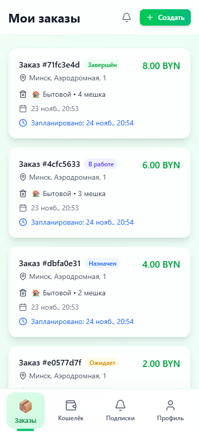
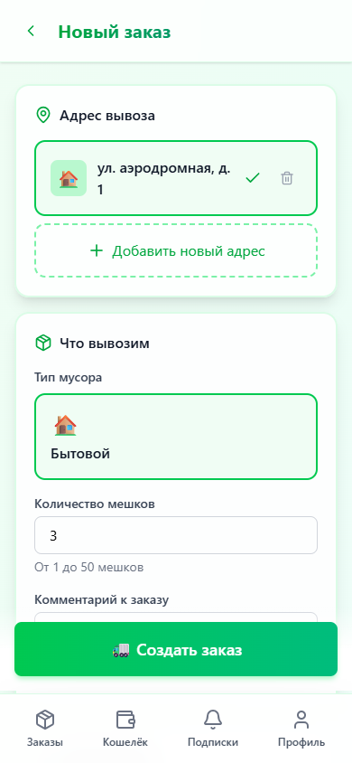
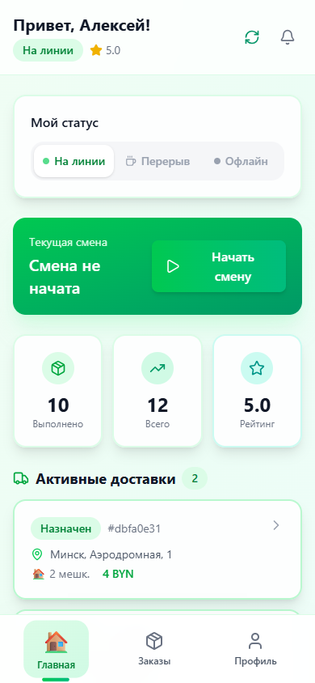
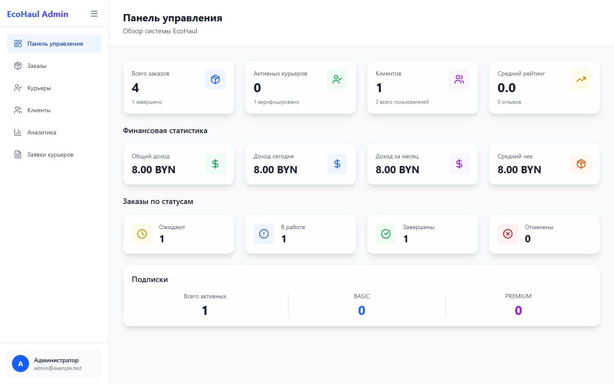
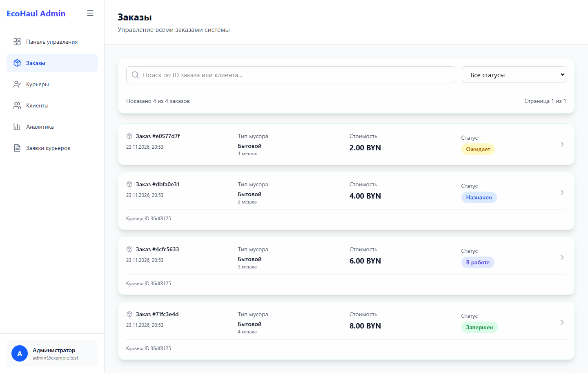
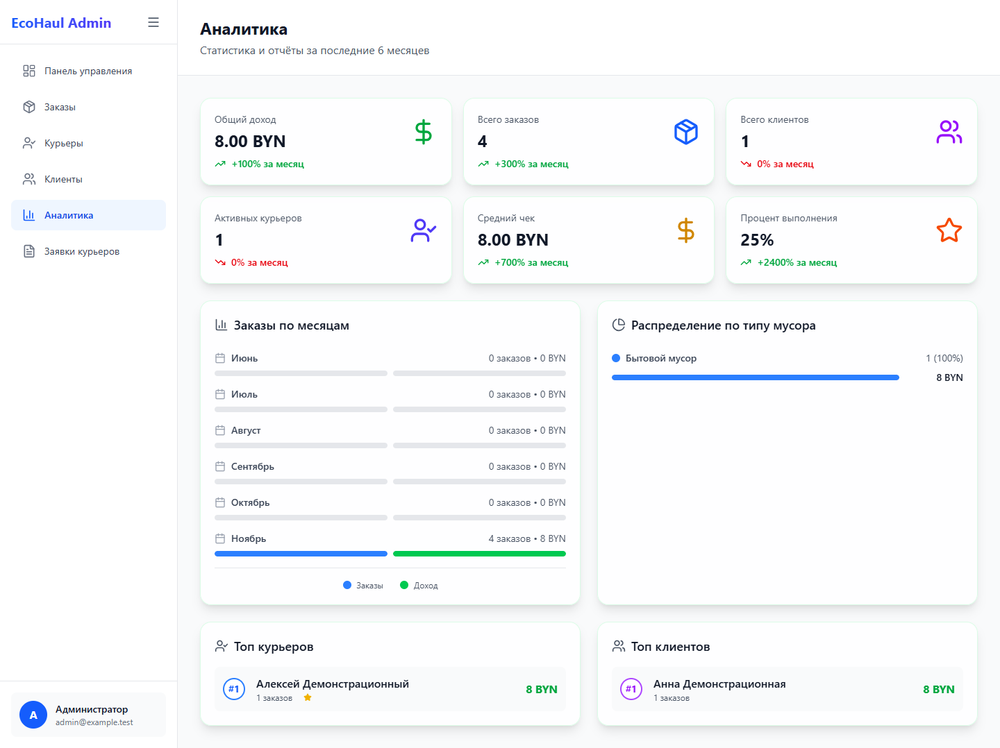
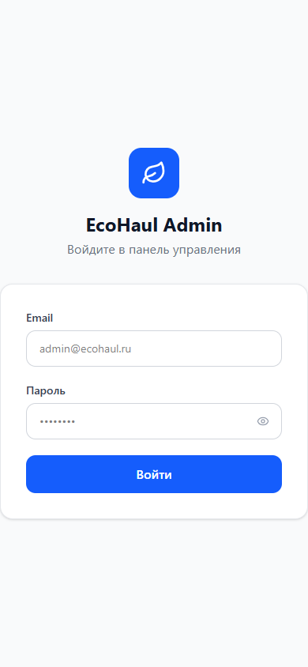

# Interface gallery

Screens captured from the running application, using an isolated demo database with
fictional users and example orders. No real customer or courier information is shown.

## Client

## Courier

## Administrator

## Mobile sign-in

